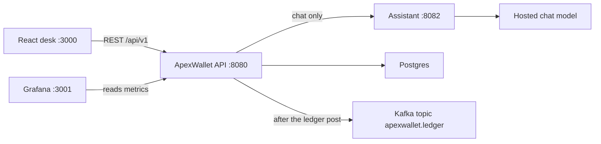
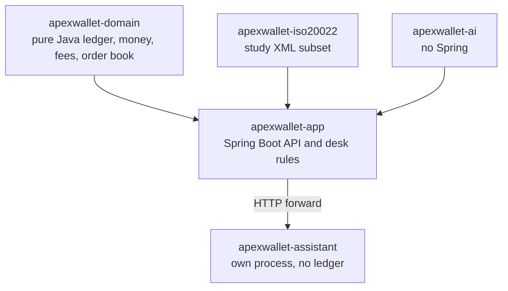
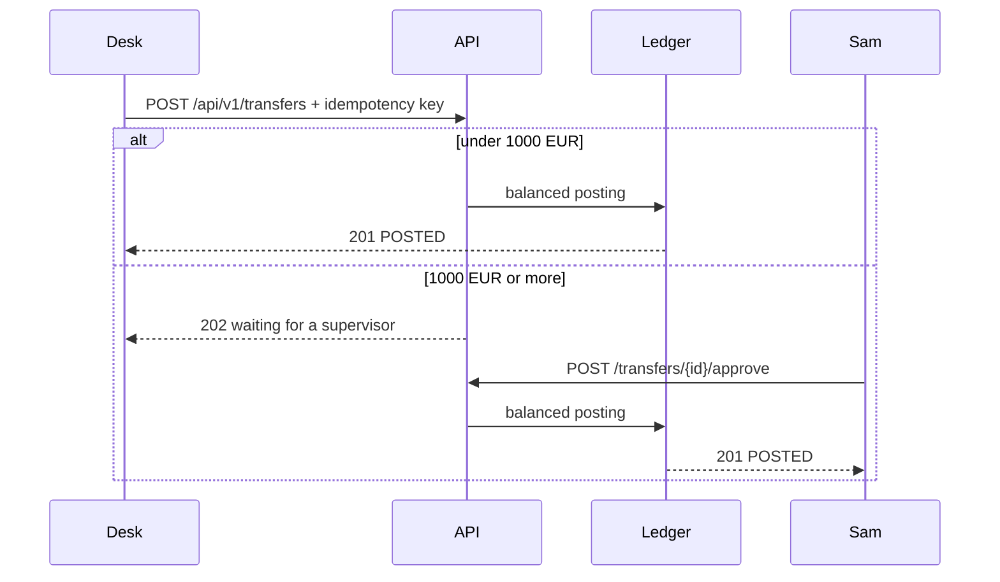

# ApexWallet

ApexWallet is a study banking desk. It is a Java and Spring Boot application with a React desk, a double-entry ledger, and one extra process for the assistant. It is a reference you can read, run, and explain. It is not certified bank software, and it is not a production payments system.

Money is stored as integer minor units (euro cents) with ISO 4217 currencies. Rounding uses half-even. The ledger never uses `double` for an amount.

## What a visitor can try

Sign in on the desk and use the study accounts below. The passwords exist only for this local demo. Do not reuse them anywhere else.

| User | Password | Role | What they can do |
| --- | --- | --- | --- |
| alice | `alice-pass-1` | Customer | Starts with €2,000.00. IBAN `GB82WEST12345698765432`. Can send, ask for a study loan, and repay. |
| bob | `bob-pass-1111` | Customer | Starts at €0.00. A second customer so Alice has someone to pay. |
| sam | `sam-supervisor-1` | Supervisor | Approves a transfer of €1,000.00 or more, and a loan above €500.00. Cannot send a transfer. |
| tim | `tim-teller-1` | Teller | Can move money for a customer. |
| aud | `aud-auditor-1` | Auditor | Can read. Cannot post a payment. |

The default run keeps these accounts in memory. They disappear when the API process stops. The Postgres profile stores them in a database. See [Profiles](#profiles).

## Features

### Accounts and sign-in

- Register and sign in with a JWT. The API is stateless.
- Roles are customer, teller, supervisor, and auditor.
- A customer sees only their own accounts. Looking up someone else's account returns 404.
- An overdraft limit is the lowest balance an account may reach. It does not add money, charge interest, or collect a debt.
- The desk can check that an IBAN is well formed. A transfer does not use the IBAN as the destination. It uses two account ids.

### Transfers

- `POST /api/v1/transfers` moves money between two accounts in one currency.
- The caller sends `X-Idempotency-Key`. Sending the same payment again with the same key returns the first result and does not move the money a second time.
- A transfer under €1,000.00 is posted immediately (`201`).
- A transfer of €1,000.00 or more waits for a different supervisor (`202`). Sam cannot approve a payment he made himself.
- The daily send limit is €5,000.00.
- Customers and tellers can post a transfer. A supervisor cannot.

### Ledger

Every posted payment is double-entry. The two sides of a transaction have the same total, and the journal is append-only. A customer balance is derived from the entries. `BANK_CASH` is the bank's cash. `FEE_INCOME` is fee income. `LOAN_RECEIVABLE` is what customers still owe on a study loan. A cached balance is checked against the folded journal.

### Study loans

The Loans page is a small sample, not a credit product.

- Up to €500.00 is paid into the customer account immediately.
- From €500.01 to €2,000.00, Sam must approve it first. Nothing is paid until he does.
- Above €2,000.00 the request is refused.
- There is no interest and no credit check. A customer can have one open loan at a time.
- Granting a loan debits the loan book and credits the customer. Repayment does the opposite and comes out of the customer's balance.

### Fees, books, and files

- Fees can be calculated and, if you choose, taken from a customer account. The other side is fee income.
- Books checks that cached balances still match the journal.
- Files checks an IBAN and can read a practice `camt` statement. That file path is a study subset of ISO 20022, not a full scheme certification.

### Markets

The order book matches study orders on one thread so the same orders replay to the same trades. A trade can post a ledger movement. It is not a production exchange.

### Assistant

The chat is the only part split into its own service.

- The React desk calls the main API at `POST /api/v1/workspace/chat`.
- The main API masks long digit runs, then forwards the messages to the assistant at `http://127.0.0.1:8082/api/v1/chat`.
- The assistant calls a hosted chat model when `APEX_MODEL_URL` and `APEX_MODEL_TOKEN` are set. Payments never call the model.
- The assistant has no database and no ledger. It cannot post a payment.
- If the assistant URL is not set, the main app can still answer in-process, so tests do not need the second process.

### Postgres, Kafka, and Grafana

These are optional profiles. They are off in the default `local` run.

- `postgres` stores accounts, the journal, users, refresh sessions, approvals, audit, idempotency, and the outbox in PostgreSQL. Flyway applies the schema.
- `kafka` publishes an outbox row after the ledger has already posted. The topic is `apexwallet.ledger`. The money does not wait for Kafka.
- Prometheus scrapes `/actuator/prometheus`. Grafana is published on host port 3001 when you start Compose.

The Access-style coverage flags for a demo video and a mutation score stay off. There is no hosted demo video and no mutation-test score in this tree.

## How the pieces fit



The four library modules are packaged into the main API. The assistant is a second jar.



## What happens when Alice sends money



A study loan uses the same ledger. The loan book is debited and Alice is credited. Repayment reverses those two sides.

## Profiles

| Profile | What it uses |
| --- | --- |
| `local` (default) | Memory ledger, memory users, no Docker. This is the fastest way to see the desk. |
| `postgres` | PostgreSQL. The same HTTP API. Alice's opening balance is one €2,000.00 deposit. |
| `kafka` | Publishes the outbox to `apexwallet.ledger` on `localhost:9092`. Add it next to `postgres`. |

`docker compose up -d` starts Postgres 16, Kafka, Prometheus, and Grafana. Grafana is on [http://localhost:3001](http://localhost:3001). The Compose Postgres user is `apex` and the password is `apex_local_only`. That password is for this laptop only.

## Run it

You need JDK 25, Maven, and Node 20 or newer. Docker is only for the Postgres, Kafka, and Grafana profiles.

PowerShell splits an unquoted `-D`, so quote those arguments.

```powershell
mvn -pl apexwallet-app -am package "-DskipTests"
java -jar apexwallet-app\target\apexwallet-app-0.8.0-SNAPSHOT.jar
```

In another terminal:

```powershell
cd web
npm install
npm run dev
```

Open [http://localhost:3000](http://localhost:3000) and sign in as Alice.

To add the assistant, put the model URL and token in a gitignored `.env` file (`APEX_MODEL_URL`, `APEX_MODEL_TOKEN`) and start the second jar:

```powershell
mvn -pl apexwallet-assistant package "-DskipTests"
java -jar apexwallet-assistant\target\apexwallet-assistant-0.8.0-SNAPSHOT.jar
java -jar apexwallet-app\target\apexwallet-app-0.8.0-SNAPSHOT.jar --apex.assistant-url=http://127.0.0.1:8082
```

The assistant listens on `127.0.0.1:8082` only. Call it as `127.0.0.1`, not a name that might resolve to IPv6.

Postgres and Kafka:

```powershell
docker compose up -d
java -jar apexwallet-app\target\apexwallet-app-0.8.0-SNAPSHOT.jar --spring.profiles.active=postgres,kafka --apex.grafana-url=http://localhost:3001/api/health
```

Do not change the committed default profile away from `local`.

## HTTP API

The React app talks only to the main API. Swagger is served at `/swagger-ui.html` when the API is running.

| Method | Path | Who | What it does |
| --- | --- | --- | --- |
| POST | `/api/v1/auth/login` | public | Returns an access token and a refresh token. |
| POST | `/api/v1/auth/refresh` | public | Rotates the refresh token. |
| GET | `/api/v1/accounts` | any signed-in role | Lists the accounts that role is allowed to see. |
| PUT | `/api/v1/accounts/{id}/overdraft` | customer, teller, supervisor | Sets the floor. It does not add cash. |
| POST | `/api/v1/transfers` | customer, teller | Posts, or waits for approval. Requires `X-Idempotency-Key`. |
| POST | `/api/v1/transfers/{id}/approve` | supervisor | Posts a waiting transfer. |
| GET | `/api/v1/loans` | any signed-in role | A customer sees their own loans. Other roles see the list. |
| POST | `/api/v1/loans` | customer | Asks for a study loan. `201` if paid now, `202` if Sam must approve. |
| POST | `/api/v1/loans/{id}/approve` | supervisor | Pays an approved loan into the account. |
| POST | `/api/v1/loans/{id}/repay` | the borrower | Pays back part or all of the outstanding amount. |
| POST | `/api/v1/workspace/chat` | signed in | Desk chat. Forwarded to the assistant when that URL is set. |
| GET | `/api/v1/workspace/reconciliation` | signed in | Compares cached balances with the journal. |
| GET | `/actuator/prometheus` | public | Metrics scrape. |

## Tests

Java modules are tested with JUnit 5 through Maven. `apexwallet-domain`, `apexwallet-iso20022`, and `apexwallet-ai` have unit tests. `apexwallet-app` adds API tests and Testcontainers for Postgres. The React desk has no test suite. Run:

```powershell
mvn test
```

## Desk map

| Page | Route | What it is |
| --- | --- | --- |
| Dashboard | `/desk` | Cards, recent movements, and a quick transfer. |
| Transactions | `/statement` | Statement lines for an account. |
| Transfer | `/transfer` | Send money. €10.00 posts now. €1,000.00 waits for Sam. |
| Accounts | `/accounts` | Balances and the overdraft floor. |
| Loans | `/loans` | Study loan, approval, and repayment. |
| Markets | `/book` | Study order book. |
| Cards | `/cards` | The customer card view. |
| Approvals | `/approvals` | Sam's queue. Hidden from other roles. |
| Tools | `/services` | Fees, books, files, and the assistant. |
| Settings | `/setting` | Session and sign-out. |

## What this project does not do

- It does not settle with a real payment scheme.
- It does not run a credit check, post loan interest, or collect a debt.
- It does not call a model when money moves.
- The whole bank is not a set of microservices. Accounts, transfers, loans, and the ledger live in one application. The assistant is the separate service.
- Demo video and mutation score are not implemented.

## Hosting

The full desk does not fit a free web host. A free instance is typically 512 MB, sleeps when idle, and cannot keep Java 25, Postgres, Kafka, Grafana, and a second assistant process running together. Render's free Postgres also expires. Fly.io has no ongoing free tier. Railway's free plan is a small monthly credit, not an always-on bank stack.

Run the default `local` profile on your own machine with the commands above. Do not publish `APEX_MODEL_TOKEN`. The `.env` file is gitignored.

## Learning notes

The `docs/` tree is the teaching programme for phases 0–17: phase packets, the handbook, and the Persian study notes. `PROGRESS.md` does not mark those phases as learner-complete. Application code in this repository is a study reference, not a claim that every line was written unaided.
